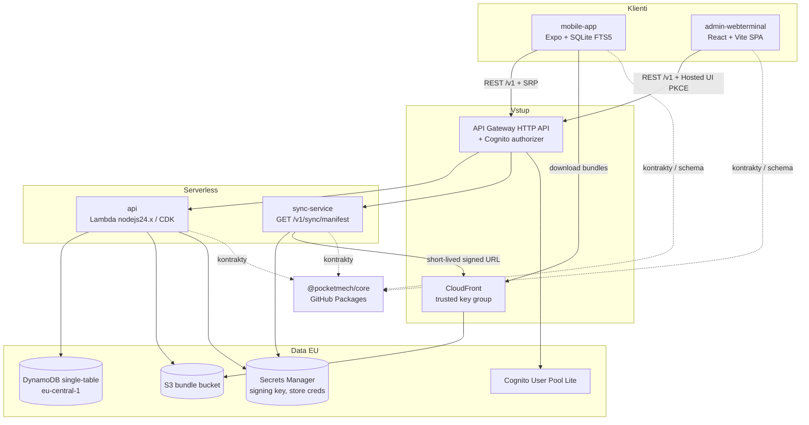

# Architektura systému PocketMech (AeroTool)

Offline-first SaaS příručka pro mechaniky B737/A320 (CB finder, cold reset, ATA kapitoly, směnové předání). Obsah je výhradně schema-driven strukturovaný NoSQL (kolekce se stovkami záznamů). Bez PDF, příloh a audia. Data residency: EU (`eu-central-1`). Bez multitenancy.

Systémová rozhodnutí: [docs/adr/](adr/).

## Komponenty

| Repo | Role |
|---|---|
| `mobile-app` | Expo (dev client, EAS), React Native Android/iOS, SQLite FTS5, offline po prvním downloadu |
| `admin-webterminal` | React + Vite SPA na S3 + CloudFront (OAC) |
| `api` | DynamoDB + CDK, CRUD, schémata, bundles publish, billing, S3 bundles + CloudFront (trusted key group) |
| `sync-service` | `GET /v1/sync/manifest`, CloudFront signed URL (signing key v Secrets Manager) |
| `core` | npm `@pocketmech/core` — kontrakty, schema, validace, migrace, entitlements |
| `.github` | Systémové ADR, sdílená CI |

Jedna API Gateway HTTP API a jeden Cognito authorizer. TypeScript všude.

## Diagram komponent

## Toky MVP (stručně)

1. **Auth:** Cognito username/password; mobile SRP + secure store; admin Hosted UI PKCE; skupiny `mechanic` / `admin`.
2. **Entitlements / billing:** store subscriptions only; verify + ASN V2 / Play RTDN; `requireEntitlement('sync')`; po expiraci purge referenčního obsahu (notes nikdy).
3. **Publish:** admin/CI → `api` bundle (202 / 409); delta + full; schémata immutable.
4. **Sync:** klient vždy → manifest; 200 bundles / 403 paywall; sha256 + transakční aplikace do FTS5.
5. **Offline:** po prvním stažení funguje bez sítě i s expired login; user notes jen lokálně.

## Otevřené předpoklady

- Offline tolerance purge **72 h** čeká na potvrzení vlastníka.
- Free tier je pouze rezervován (nic není zdarma v MVP).

Detailní rozhodnutí: ADR 0000–0007.
