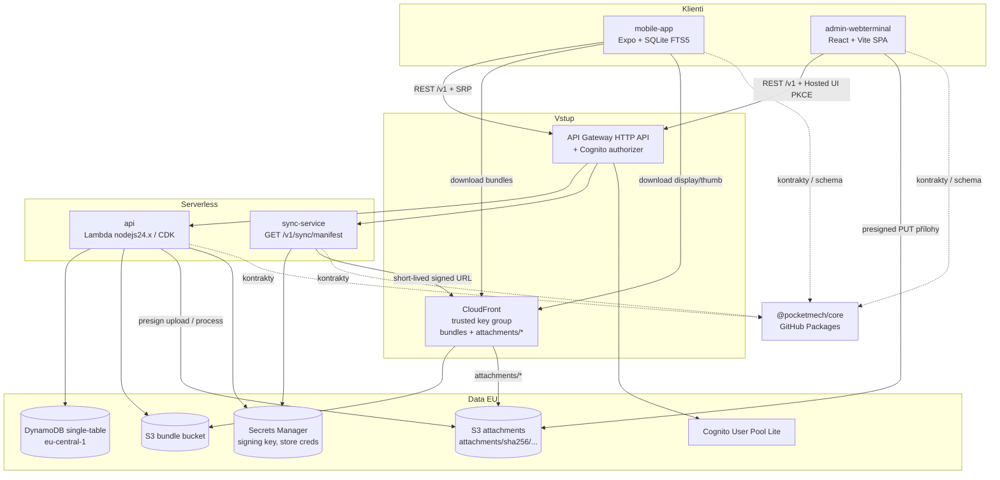

# Architektura systému PocketMech (AeroTool)

Offline-first SaaS příručka pro mechaniky B737/A320 (CB finder, cold reset, ATA kapitoly, směnové předání). Obsah je výhradně schema-driven strukturovaný NoSQL (kolekce se stovkami záznamů). Záznamy mohou volitelně mít přílohy, hlavně fotky; PDF ne (viz [docs/adr/0008-prilohy.md](adr/0008-prilohy.md)). Data residency: EU (`eu-central-1`). Bez multitenancy.

Systémová rozhodnutí: [docs/adr/](adr/).

## Rejstřík ADR

| ADR | Název |
|---|---|
| [0000](adr/0000-proces-a-sablona.md) | Proces ADR a šablona |
| [0001](adr/0001-prehled-a-hranice.md) | Přehled a hranice komponent |
| [0002](adr/0002-datovy-model.md) | Datový model (DynamoDB single-table) |
| [0003](adr/0003-api-a-aws-stack.md) | API a AWS stack |
| [0004](adr/0004-schema-driven-ui-a-evoluce.md) | Schema-driven UI a evoluce schémat |
| [0005](adr/0005-delta-content-sync.md) | Delta content sync |
| [0006](adr/0006-auth-entitlements-billing.md) | Auth, entitlements a billing |
| [0007](adr/0007-core-distribuce.md) | Distribuce balíčku core |
| [0008](adr/0008-prilohy.md) | Přílohy |

## Komponenty

| Repo | Role |
|---|---|
| `mobile-app` | Expo (dev client, EAS), React Native Android/iOS, SQLite FTS5, offline po prvním downloadu (bundly + přílohy) |
| `admin-webterminal` | React + Vite SPA na S3 + CloudFront (OAC) |
| `api` | DynamoDB + CDK, CRUD, schémata, bundles publish, billing, S3 bundles + CloudFront (trusted key group), S3 přílohy + CloudFront `attachments/*` |
| `sync-service` | `GET /v1/sync/manifest`, CloudFront signed URL (bundly i přílohy; signing key v Secrets Manager) |
| `core` | npm `@pocketmech/core` — kontrakty, schema, validace, migrace, entitlements |
| `.github` | Systémové ADR, sdílená CI |

Jedna API Gateway HTTP API a jeden Cognito authorizer. TypeScript všude.

## Diagram komponent

## Toky MVP (stručně)

1. **Auth:** Cognito username/password; mobile SRP + secure store; admin Hosted UI PKCE; skupiny `mechanic` / `admin`.
2. **Entitlements / billing:** store subscriptions only; verify + ASN V2 / Play RTDN; `requireEntitlement('sync')`; po expiraci purge referenčního obsahu včetně příloh (notes nikdy).
3. **Publish:** admin/CI → `api` bundle (202 / 409); delta + full; schémata immutable.
4. **Sync:** klient vždy → manifest (`?dataVersion=&schemas=…`); 200 bundles / 403 paywall / 426 upgrade; sha256 + transakční aplikace do FTS5.
5. **Přílohy:** admin upload (presigned PUT) → zpracování v `api` → CloudFront `attachments/*`; manifest nese `attachments { baseUrl, signedQuery, expiresAt, totalBytes }`; mobil stáhne display/thumb offline (ADR 0008).
6. **Offline:** po prvním stažení funguje bez sítě i s expired login; user notes jen lokálně.

## Otevřené předpoklady

- Offline tolerance purge **72 h** čeká na potvrzení vlastníka.
- Free tier je pouze rezervován (nic není zdarma v MVP).

Detailní rozhodnutí: ADR 0000–0008 (viz rejstřík výše).
