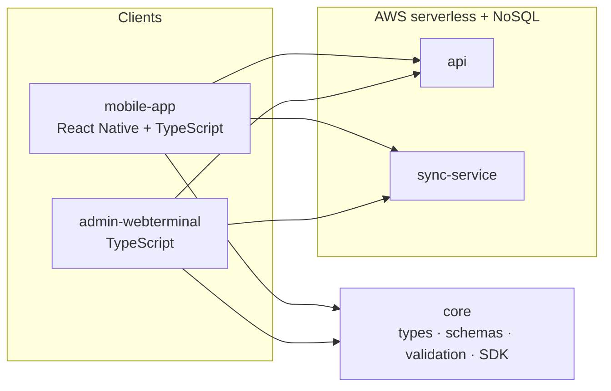

  

  

  
  
  
  

# PocketMech

**Offline pocket tooling for licensed aircraft mechanics — AeroTool.**

PocketMech builds **AeroTool**, an offline-first pocket reference for licensed aircraft mechanics working on **B737** and **A320** fleets. It helps with:

- Circuit breaker lookup
- Cold reset procedures
- ATA chapter navigation
- Shift handover

> **Disclaimer:** AeroTool is a **reference aid only**. It does **not** replace official maintenance documentation (AMM or equivalent). Always follow approved procedures and current operator documentation.

Maintained by [@Bercek71](https://github.com/Bercek71).

## Repositories

| Repository | Role |
|---|---|
| [`.github`](https://github.com/PocketMech/.github) | Organization profile and shared GitHub configuration |
| [`mobile-app`](https://github.com/PocketMech/mobile-app) | React Native + TypeScript mobile application |
| [`core`](https://github.com/PocketMech/core) | Shared TypeScript library: types, schemas, validation, SDK |
| [`sync-service`](https://github.com/PocketMech/sync-service) | Synchronization service |
| [`admin-webterminal`](https://github.com/PocketMech/admin-webterminal) | TypeScript web admin terminal |
| [`api`](https://github.com/PocketMech/api) | Serverless API on AWS |

## Architecture

`mobile-app` and `admin-webterminal` depend on `core`. Clients talk to `api` and `sync-service`, which run as AWS serverless workloads backed by NoSQL storage.

Architecture Decision Records live in [`docs/adr/`](../docs/adr/) and are owned by the System Architect.

## Roadmap (plan)

This is a **planned** sequence — not a committed schedule and **not dated**:

1. Repository foundations and CI
2. `core` types and schema
3. MVP offline mobile application
4. Sync
5. Admin terminal

## Contributing

See [CONTRIBUTING.md](../CONTRIBUTING.md) for gitflow, branch naming, Conventional Commits, and the pull request checklist.

Every change lands as a pull request into `develop` and requires review by [@Bercek71](https://github.com/Bercek71). Direct pushes to `main` or `develop` are not allowed.

## Security

Report vulnerabilities through GitHub Private Vulnerability Reporting. Details: [SECURITY.md](../SECURITY.md).

## Support

How to get help and where to ask questions: [SUPPORT.md](../SUPPORT.md).

## Code of Conduct

This organization follows the Contributor Covenant. See [CODE_OF_CONDUCT.md](../CODE_OF_CONDUCT.md).
